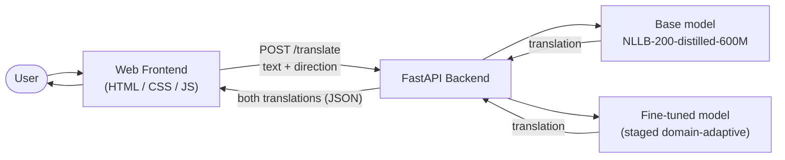

# English–Asante Twi Neural Machine Translation — Comparison App

A web application that translates between English and Asante Twi using two models
side by side: the unadapted base model (NLLB-200-distilled-600M) and a fine-tuned
model adapted to Asante Twi through staged domain-adaptive fine-tuning.

## What it does

Given a sentence and a direction (English→Twi or Twi→English), the app runs the
input through both the base and the fine-tuned models and shows their translations
together, so the effect of the fine-tuning can be seen directly.(Not perfect due to lack of training data)

## Tech stack

- **Backend:** Python, FastAPI — loads both models at start-up and exposes a translation endpoint
- **Frontend:** HTML, CSS, JavaScript — single-page interface
- **Models:** Hugging Face Transformers (NLLB-200-distilled-600M base + fine-tuned checkpoint)

## Architecture

The system has three parts: a browser-based frontend, a FastAPI backend, and the two
translation models the backend serves.

1. **Frontend.** A single HTML/CSS/JavaScript page where the user types a sentence and
   chooses a direction (English→Twi or Twi→English). On submit, it sends the text and
   direction to the backend as a `POST /translate` request.
2. **Backend.** A FastAPI application that loads **both** models once at start-up, so no
   model is reloaded per request and response time reflects only inference. For each
   request it sets the source and target language, runs the input through the base model
   and the fine-tuned model, and returns both translations together as JSON.
3. **Models.** The base model is `NLLB-200-distilled-600M`. The fine-tuned model is the
   same architecture after staged, domain-adaptive fine-tuning on Asante Twi data, using
   a rehearsal anchor and a low learning rate to add domains without catastrophic
   forgetting.

Running the two models side by side on the same input is the point of the system: it makes
the effect of the fine-tuning directly visible, rather than reporting it only as a score.

## Running locally

1. Install dependencies:

       pip install -r requirements.txt

2. Start the backend (replace `main` with your backend filename if different):

       uvicorn main:app --reload

3. Open the frontend (`index.html`) in a browser, or visit the URL the server prints.

## Note on the models

The fine-tuned model checkpoint is not included in this repository because of its
size but available on request

## License

The fine-tuned model is derived in part from MAFAND-MT data, which is released for
non-commercial use; this constraint is inherited by the model.